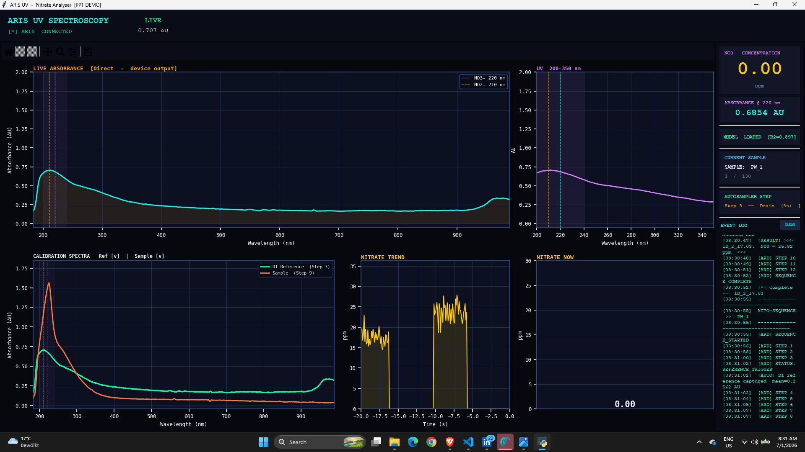
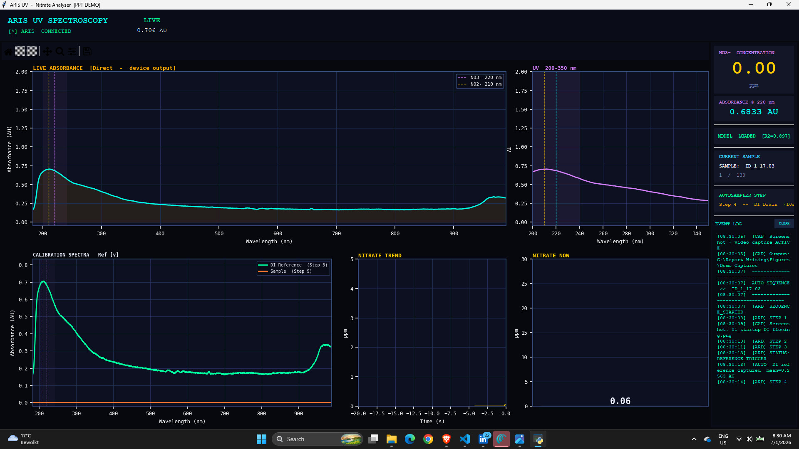
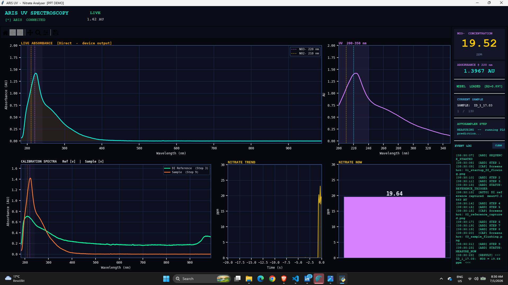
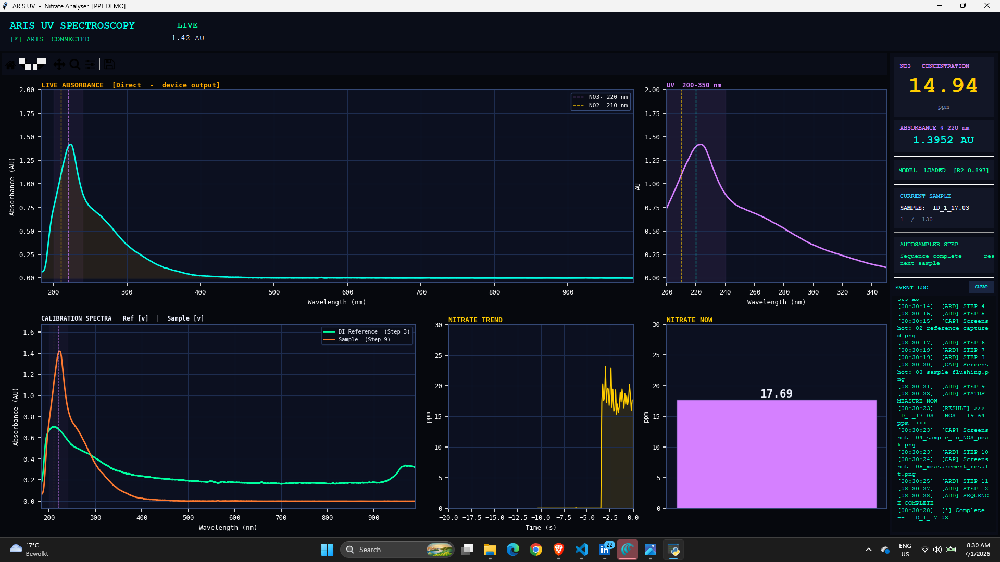

# Real-Time UV-Vis Nitrate Analyser

Machine Learning-Enhanced Real-Time UV Spectroscopic Monitoring of Soil Nitrate. M.Sc. thesis project, Hochschule Furtwangen / Hahn-Schickard, Oct 2025 - Jun 2026.

An automated measurement rig and live software that takes a pore-water sample through a UV-Vis flow cell, records the absorbance spectrum, and predicts nitrate concentration (ppm) with a PLS regression model.

## Real-time GUI

Live absorbance spectrum, UV 200-350 nm zoom, DI-reference vs sample overlay, nitrate trend and current value, autosampler step tracker and event log. The screenshots come from `gui/Demo_Simulation.py`, which replays recorded spectra through the full 12-step autosampler sequence without hardware. A recording is in [docs/Demo_Video.mp4](docs/Demo_Video.mp4).

| | |
|---|---|
|  |  |
| DI reference captured | Sample in cell, nitrate peak near 220 nm |
|  |  |
| PLS result | Reference and sample overlay |

## Performance

| Item | Value |
|---|---|
| Method | PLS regression on 215-380 nm, Savitzky-Golay 1st derivative, 9 latent variables |
| Calibration set | n = 132 samples |
| Validation | Leave-one-out cross-validation |
| **LOO-CV R²** | **0.897** |
| **RMSECV** | **7.28 ppm** |
| Measurements operated | 1000+ |
| Spectrometer | Avenir Photonics Aris, 2048 px, 183-989 nm |

Samples are porewater from a lysimeter test site (reference nitrate by a lab method). Alternatives (PCA, LASSO, single-wavelength calibration at 220/275/254/302 nm) were compared; single-wavelength methods performed far worse than PLS. The early baseline model (SNV + 1st derivative, 6 LVs, 200-400 nm) is shown below; preprocessing, wavelength range, latent-variable count and outlier handling were then optimised by grid search.

*Fig. 4 is the early baseline (LOO-CV R² 0.68), not the final model.*

## Repository

| Folder | Content |
|---|---|
| `gui/` | `realtime_gui.py` (live acquisition GUI), `Demo_Simulation.py` (hardware-free demo), `Capture_Demo.py` (screenshot/video capture) |
| `firmware/` | ESP32 autosampler sketch and Raspberry Pi Pico variant (pumps and valves) |
| `analysis/` | model training and optimisation, validation, spectral QC |
| `hardware_tests/` | pump, serial-port and spectrometer USB tests |
| `cad_3d_prints/` | STL files of the 3D-printed parts: cuvette/flow-cell holders (5.7 to 6 mm variants), light-tight black box, caps, sample holder. Designed in Onshape, printed for the rig |

Raw spectra (.spz) and trained models are not included. Stack: Python, scikit-learn, SciPy, Matplotlib/Tkinter, Arduino C++, MATLAB.

